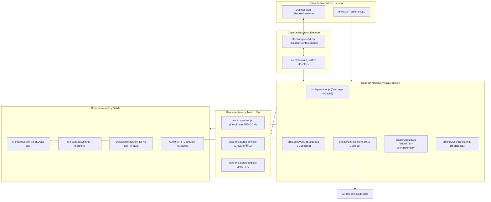

# Arquitectura del Sistema e Ingeniería Inversa 🏛️

Este documento describe en profundidad los aspectos técnicos, de ingeniería inversa y diseño de software implementados en el scraper y descargador de novelas de WTR-LAB.

---

## 1. Diagrama de Arquitectura Global



---

## 2. Ingeniería Inversa de WTR-LAB

WTR-LAB es una aplicación web SPA construida con **Next.js**. Tras analizar sus bundles JavaScript empaquetados (`turbopack`), se descubrieron sus APIs internas y esquemas de datos:

### A. Búsqueda de Novelas
- **Endpoint**: `POST https://wtr-lab.com/api/search`
- **Payload**: `{"text": "<nombre_o_termino>"}`
- **Respuesta**:
  ```json
  {
    "success": true,
    "data": [
      {
        "id": 107761,
        "raw_id": 112330,
        "slug": "mortal-wonders-of-the-heavens-enjoying-eternal-life",
        "data": {
          "title": "Mortal: Wonders of the Heavens, Enjoying Eternal Life",
          "author": "Long Zhi Han",
          "description": "..."
        },
        "chapter_count": 296
      }
    ]
  }
  ```

### B. Listado de Capítulos
- **Endpoint**: `GET https://wtr-lab.com/api/chapters/[raw_id]`
- **Respuesta**:
  ```json
  {
    "chapters": [
      {
        "id": 57143069,
        "order": 1,
        "title": "Chapter 1: The Remnants of the Untold Story",
        "name": "第1章 异宝残根"
      }
    ]
  }
  ```

### C. Descarga y Resolución de Capítulos
- **Endpoint**: `POST https://wtr-lab.com/api/reader/get`
- **Payload**:
  ```json
  {
    "raw_id": 112330,
    "chapter_no": 1,
    "language": "en",
    "translate": "ai"
  }
  ```
- **Respuesta de Firma**:
  ```json
  {
    "success": true,
    "chapter": { "id": 57143069, "order": 1, "title": "..." },
    "content_url": "/api/v2/reader/content/v1/ai/112330/57143069/en/2d3a6440.../108/1794441600/G4f6Ic..."
  }
  ```
  La URL firmada (`content_url`) es de un solo uso temporal y entrega el JSON con el contenido real del capítulo.

---

## 3. Decodificación de Gemini y Glosario Oficial

Cuando se solicita `translate: "ai"`, el JSON contiene:
- `data.data.body`: Array de strings con los párrafos en inglés generados por Gemini.
- `data.data.glossary_data.terms`: Diccionario de tuplas `[término_traducido, término_original]`.
- En el texto, los nombres propios son reemplazados por tokens de posición: `※29⛬`.

### Algoritmo de sustitución implementado:
```javascript
const replaced = paragraph.replace(/※(\d+)[⛬〓〘〙【】]?/g, (match, indexStr) => {
  const idx = parseInt(indexStr, 10);
  const termEntry = terms[idx];
  return (termEntry && termEntry[0]) ? termEntry[0].replace(/_/g, ' ') : match;
});
```

---

## 4. Descifrado Criptográfico AES-GCM (Servicio Web)

Si una novela no dispone de versión Gemini (`translate: "ai"`), WTR-LAB entrega el texto en bruto en chino cifrado para evitar copias directas:
```text
arr:IV_BASE64:AUTH_TAG_BASE64:CIPHERTEXT_BASE64
```

### Parámetros Criptográficos:
- **Algoritmo**: `AES-GCM` (Galois/Counter Mode).
- **Tamaño de Clave**: 256 bits (32 bytes UTF-8).
- **Clave Estática Extraída**: `IJAFUUxjM25hyzL2AZrn0wl7cESED6Ru`
- **Reconstrucción de Buffer**: En la API estándar `SubtleCrypto` de WebCrypto, el `authTag` de 16 bytes debe concatenarse al final del `ciphertext` antes de invocar `decrypt`.

---

## 5. Traductor de Alto Rendimiento por Lotes (Google Translate)

Para traducir del inglés al español (o del chino al español en fallback):
- Se utiliza el endpoint RPC de Google Translate: `https://translate.googleapis.com/translate_a/single?client=gtx&sl=...&tl=...`
- Se empaquetan párrafos en lotes de hasta **800 caracteres** para evitar límites de longitud en URLs HTTP.
- Se intercalan delimitadores numéricos seguros `[[--9999--]]` que Google Translate no altera, permitiendo reconstruir los párrafos intactos en el idioma destino.

---

## 6. Motor PDF y Prevención de Páginas Fantasma

Al generar PDFs con `pdfkit`:
- El documento maneja márgenes de `54pt`.
- Escribir pie de página fuera del margen (`height - 35`) causaba que `pdfkit` interpretara un desbordamiento vertical, insertando una página en blanco por cada página de texto.
- **Solución implementada**:
  ```javascript
  doc.page.margins.bottom = 0;
  doc.text(`Página ${i + 1} de ${totalPages}`, 54, doc.page.height - 35, {
    align: 'center',
    width: doc.page.width - 108,
    lineBreak: false
  });
  doc.page.margins.bottom = oldBottom;
  ```
  Esto garantiza que el documento tenga exactamente las páginas que ocupa el contenido, sin páginas vacías.

---

## 7. Lector Integrado y Continuación de Lectura (Binge Reading)

El lector offline integrado en `electron/renderer/` proporciona una experiencia fluida sin fricción:
- **Persistencia de progreso**: `reading_progress` en SQLite registra automáticamente la novela, el último capítulo y el idioma al abrir cualquier lectura.
- **Botón dinámico "Siguiente"**:
  - Si el capítulo siguiente ya está en caché local, realiza un cambio instantáneo de capítulo.
  - Si se alcanza el último capítulo disponible, el botón muta a `Descargar Sig. (Cap. N+1)` con estilo prioritario.
  - Al pulsarlo, el proceso principal de Electron descarga y procesa el capítulo en segundo plano vía `novel:download`, lo persiste en SQLite y lo proyecta inmediatamente en el lector sin cerrar la vista.
- **Tarjeta de finalización**: Al llegar al último párrafo, se despliega una interfaz que permite descargar un único capítulo o un lote de 5 capítulos con un solo clic.

---

## 8. Motor de Síntesis de Voz Neural (TTS) y Marcas Temporales

- Utiliza `node-edge-tts` con streaming sobre WebSocket.
- Captura eventos `WordBoundary` con marcas de tiempo relativas (en milisegundos) para cada palabra sintetizada.
- Cada palabra en el DOM se envuelve en un elemento `.reader-word`, permitiendo al usuario hacer clic en cualquier palabra para iniciar la reproducción auditiva exactamente desde esa posición (`playFromWord`).
- Permite la exportación completa del capítulo a un archivo `.mp3` en `exports/<novela>/audio/`.

---

## 9. Exploración de Series y Tabla de Contenidos Dinámica (TOC)

El explorador de series en la vista de búsqueda integra la Tabla de Contenidos completa y en tiempo real:
- **Obtención asíncrona de metadatos**: Al inspeccionar una serie, se consulta el endpoint `GET /api/chapters/[raw_id]` a través del handler IPC `novel:getChapters`.
- **Estructura enriquecida**: Cada capítulo expone su número canónico (`order`), título en inglés/traducción (`title`), título original en caracteres asiáticos (`rawTitle`) y fecha de actualización.
- **Buscador interactivo en el modal**: La función `renderModalTableOfContents` filtra los capítulos en tiempo real según el término ingresado, actualizando métricas dinámicas (`Mostrando X de Y capítulos`).
- **Selector de rango por clic**:
  - `btn-toc-pick`: Establece el capítulo cliqueado como objetivo único en el campo de rango.
  - `btn-toc-range-to`: Construye un rango desde el capítulo inicial seleccionado hasta el capítulo actual (`start-end`).
  - Resaltado visual reactivo: `highlightSelectedTocChapters` actualiza la clase `.selected` en todos los ítems dentro del rango ingresado.
- **Modo expandido**: Permite colapsar el formulario de opciones y extender la lista de capítulos a toda la altura disponible (`.toc-expanded`) para navegar colecciones de más de 1000 capítulos sin saturar la pantalla.

---

## 10. Ciclo de Desarrollo y Regla de Documentación

Conforme al skill `.agents/skills/novel-hunter-workflow/SKILL.md`:
1. Implementación de feature.
2. Pruebas automatizadas (`test/verify.js`, `test/test_db.js`).
3. Verificación verde al 100%.
4. **Actualización obligatoria de toda la documentación** (`README.md`, `docs/`, `AGENTS.md`).
5. Commit formal con Conventional Commits.

---

## 11. Eliminación Segura de Novelas y Capítulos

Para mantener limpia la biblioteca y optimizar el almacenamiento:
- **IPC Handlers**:
  - `novel:delete`: Elimina la novela en SQLite y borra recursivamente la carpeta física de exportaciones (`exports/<slug>/`).
  - `novel:deleteChapters`: Elimina capítulos canónicos o traducciones por idioma y borra los archivos individuales `.txt` y `.mp3` correspondientes en disco.
- **Cascada Relacional 3NF**: El borrado en SQLite activa las restricciones `ON DELETE CASCADE` de `chapters`, `chapter_translations`, `paragraphs` y `reading_progress`.
- **Puntos de Interacción en la UI**:
  - Centralizados exclusivamente dentro del detalle de la novela (`#chapters-modal`), manteniendo las tarjetas de la biblioteca y el lector libres de saturación:
    - Botón *"Borrar Capítulos"* (`#detail-delete-chapters-btn`) en la barra de acciones de la novela (`.novel-meta-actions`), con diálogo modal para selección por rangos (`1-10`, `all`) e idioma.
    - Botón *"Eliminar Novela Completa"* (`#detail-delete-novel-btn`) en la barra de acciones con confirmación previa irreversible.
    - Botón individual *"Borrar"* en cada fila de capítulo (`.btn-delete-ch`) dentro de la lista de capítulos de la novela.

---

## 12. Paginación y Acordeón Configurable de Capítulos

Para optimizar la visualización de novelas con cientos o miles de capítulos guardados, Novel Hunter implementa un sistema de particionado dinámico en acordeones:
- **Configuración Numérica de Usuario**:
  - Ubicada en la pestaña de *Configuración* (`#tab-settings`), permite definir la cantidad exacta de capítulos a agrupar en cada bloque desplegable mediante un selector numérico (`#chapter-group-size-input`) y chips de acceso rápido (`10`, `20`, `50`, `100`).
  - Persistencia en `data/settings.json` mediante las funciones `getChapterGrouping()` y `saveChapterGrouping(size)` de `src/config.js`.
  - Canales IPC dedicados: `settings:getChapterGrouping` y `settings:saveChapterGrouping`.
- **Renderizado Dinámico de Acordeones**:
  - Los capítulos recuperados de SQLite se segmentan en bloques del tamaño configurado (por ejemplo, 10 o 20 por bloque).
  - Cada acordeón muestra su rango de capítulos (ej. `Capítulos 1 – 20`), un badge con el conteo de capítulos y un icono indicador con rotación CSS suave de 90°.
  - **Barra de Herramientas**: Muestra un resumen general (`Total: X capítulos en Y grupos`) y controles rápidos para *"Expandir todos"* o *"Colapsar todos"*.
  - **Apertura Inteligente**: Se abre automáticamente el acordeón correspondiente al último capítulo leído (`last_read_chapter_no`) para retomar la lectura sin necesidad de desplazamiento.
