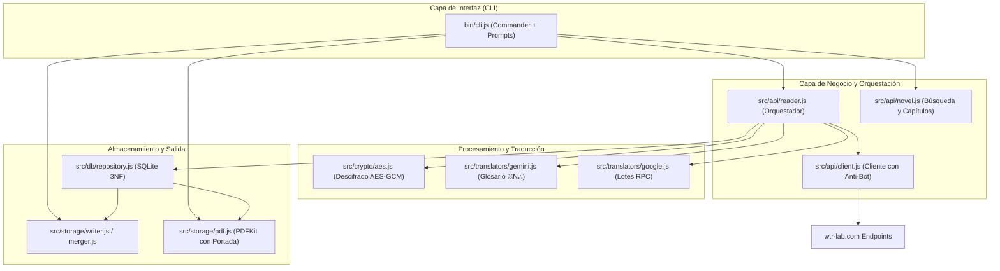

# Arquitectura del Sistema e Ingeniería Inversa 🏛️

Este documento describe en profundidad los aspectos técnicos, de ingeniería inversa y diseño de software implementados en el scraper y descargador de novelas de WTR-LAB.

---

## 1. Diagrama de Arquitectura Global



---

## 2. Ingeniería Inversa de WTR-LAB

WTR-LAB es una aplicación web SPA construida con **Next.js**. Tras analizar sus bundles JavaScript empaquetados (`turbopack`), se descubrieron sus APIs internas y esquemas de datos:

### A. Búsqueda de Novelas
- **Endpoint**: `POST https://wtr-lab.com/api/search`
- **Payload**: `{"text": "<nombre_o_termino>"}`
- **Respuesta**:
  ```json
  {
    "success": true,
    "data": [
      {
        "id": 107761,
        "raw_id": 112330,
        "slug": "mortal-wonders-of-the-heavens-enjoying-eternal-life",
        "data": {
          "title": "Mortal: Wonders of the Heavens, Enjoying Eternal Life",
          "author": "Long Zhi Han",
          "description": "..."
        },
        "chapter_count": 296
      }
    ]
  }
  ```

### B. Listado de Capítulos
- **Endpoint**: `GET https://wtr-lab.com/api/chapters/[raw_id]`
- **Respuesta**:
  ```json
  {
    "chapters": [
      {
        "id": 57143069,
        "order": 1,
        "title": "Chapter 1: The Remnants of the Untold Story",
        "name": "第1章 异宝残根"
      }
    ]
  }
  ```

### C. Descarga y Resolución de Capítulos
- **Endpoint**: `POST https://wtr-lab.com/api/reader/get`
- **Payload**:
  ```json
  {
    "raw_id": 112330,
    "chapter_no": 1,
    "language": "en",
    "translate": "ai"
  }
  ```
- **Respuesta de Firma**:
  ```json
  {
    "success": true,
    "chapter": { "id": 57143069, "order": 1, "title": "..." },
    "content_url": "/api/v2/reader/content/v1/ai/112330/57143069/en/2d3a6440.../108/1794441600/G4f6Ic..."
  }
  ```
  La URL firmada (`content_url`) es de un solo uso temporal y entrega el JSON con el contenido real del capítulo.

---

## 3. Decodificación de Gemini y Glosario Oficial

Cuando se solicita `translate: "ai"`, el JSON contiene:
- `data.data.body`: Array de strings con los párrafos en inglés generados por Gemini.
- `data.data.glossary_data.terms`: Diccionario de tuplas `[término_traducido, término_original]`.
- En el texto, los nombres propios son reemplazados por tokens de posición: `※29⛬`.

### Algoritmo de sustitución implementado:
```javascript
const replaced = paragraph.replace(/※(\d+)[⛬〓〘〙【】]?/g, (match, indexStr) => {
  const idx = parseInt(indexStr, 10);
  const termEntry = terms[idx];
  return (termEntry && termEntry[0]) ? termEntry[0].replace(/_/g, ' ') : match;
});
```

---

## 4. Descifrado Criptográfico AES-GCM (Servicio Web)

Si una novela no dispone de versión Gemini (`translate: "ai"`), WTR-LAB entrega el texto en bruto en chino cifrado para evitar copias directas:
```text
arr:IV_BASE64:AUTH_TAG_BASE64:CIPHERTEXT_BASE64
```

### Parámetros Criptográficos:
- **Algoritmo**: `AES-GCM` (Galois/Counter Mode).
- **Tamaño de Clave**: 256 bits (32 bytes UTF-8).
- **Clave Estática Extraída**: `IJAFUUxjM25hyzL2AZrn0wl7cESED6Ru`
- **Reconstrucción de Buffer**: En la API estándar `SubtleCrypto` de WebCrypto, el `authTag` de 16 bytes debe concatenarse al final del `ciphertext` antes de invocar `decrypt`.

---

## 5. Traductor de Alto Rendimiento por Lotes (Google Translate)

Para traducir del inglés al español (o del chino al español en fallback):
- Se utiliza el endpoint RPC de Google Translate: `https://translate.googleapis.com/translate_a/single?client=gtx&sl=...&tl=...`
- Se empaquetan párrafos en lotes de hasta **800 caracteres** para evitar límites de longitud en URLs HTTP.
- Se intercalan delimitadores numéricos seguros `[[--9999--]]` que Google Translate no altera, permitiendo reconstruir los párrafos intactos en el idioma destino.

---

## 6. Motor PDF y Prevención de Páginas Fantasma

Al generar PDFs con `pdfkit`:
- El documento maneja márgenes de `54pt`.
- Escribir pie de página fuera del margen (`height - 35`) causaba que `pdfkit` interpretara un desbordamiento vertical, insertando una página en blanco por cada página de texto.
- **Solución implementada**:
  ```javascript
  doc.page.margins.bottom = 0;
  doc.text(`Página ${i + 1} de ${totalPages}`, 54, doc.page.height - 35, {
    align: 'center',
    width: doc.page.width - 108,
    lineBreak: false
  });
  doc.page.margins.bottom = oldBottom;
  ```
  Esto garantiza que el documento tenga exactamente las páginas que ocupa el contenido, sin páginas vacías.
