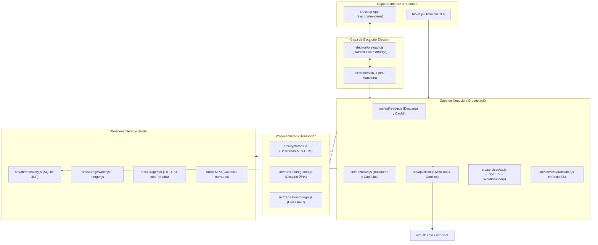

# Arquitectura del Sistema e Ingeniería Inversa 🏛️

Este documento describe en profundidad los aspectos técnicos, de ingeniería inversa y diseño de software implementados en el scraper y descargador de novelas de WTR-LAB.

---

## 1. Diagrama de Arquitectura Global



---

## 2. Ingeniería Inversa de WTR-LAB

WTR-LAB es una aplicación web SPA construida con **Next.js**. Tras analizar sus bundles JavaScript empaquetados (`turbopack`), se descubrieron sus APIs internas y esquemas de datos:

### A. Búsqueda de Novelas
- **Endpoint**: `POST https://wtr-lab.com/api/search`
- **Payload**: `{"text": "<nombre_o_termino>"}`
- **Respuesta**:
  ```json
  {
    "success": true,
    "data": [
      {
        "id": 107761,
        "raw_id": 112330,
        "slug": "mortal-wonders-of-the-heavens-enjoying-eternal-life",
        "data": {
          "title": "Mortal: Wonders of the Heavens, Enjoying Eternal Life",
          "author": "Long Zhi Han",
          "description": "..."
        },
        "chapter_count": 296
      }
    ]
  }
  ```

### B. Listado de Capítulos
- **Endpoint**: `GET https://wtr-lab.com/api/chapters/[raw_id]`
- **Respuesta**:
  ```json
  {
    "chapters": [
      {
        "id": 57143069,
        "order": 1,
        "title": "Chapter 1: The Remnants of the Untold Story",
        "name": "第1章 异宝残根"
      }
    ]
  }
  ```

### C. Descarga y Resolución de Capítulos
- **Endpoint**: `POST https://wtr-lab.com/api/reader/get`
- **Payload**:
  ```json
  {
    "raw_id": 112330,
    "chapter_no": 1,
    "language": "en",
    "translate": "ai"
  }
  ```
- **Respuesta de Firma**:
  ```json
  {
    "success": true,
    "chapter": { "id": 57143069, "order": 1, "title": "..." },
    "content_url": "/api/v2/reader/content/v1/ai/112330/57143069/en/2d3a6440.../108/1794441600/G4f6Ic..."
  }
  ```
  La URL firmada (`content_url`) es de un solo uso temporal y entrega el JSON con el contenido real del capítulo.

---

## 3. Decodificación de Gemini y Glosario Oficial

Cuando se solicita `translate: "ai"`, el JSON contiene:
- `data.data.body`: Array de strings con los párrafos en inglés generados por Gemini.
- `data.data.glossary_data.terms`: Diccionario de tuplas `[término_traducido, término_original]`.
- En el texto, los nombres propios son reemplazados por tokens de posición: `※29⛬`.

### Algoritmo de sustitución implementado:
```javascript
const replaced = paragraph.replace(/※(\d+)[⛬〓〘〙【】]?/g, (match, indexStr) => {
  const idx = parseInt(indexStr, 10);
  const termEntry = terms[idx];
  return (termEntry && termEntry[0]) ? termEntry[0].replace(/_/g, ' ') : match;
});
```

---

## 4. Descifrado Criptográfico AES-GCM (Servicio Web)

Si una novela no dispone de versión Gemini (`translate: "ai"`), WTR-LAB entrega el texto en bruto en chino cifrado para evitar copias directas:
```text
arr:IV_BASE64:AUTH_TAG_BASE64:CIPHERTEXT_BASE64
```

### Parámetros Criptográficos:
- **Algoritmo**: `AES-GCM` (Galois/Counter Mode).
- **Tamaño de Clave**: 256 bits (32 bytes UTF-8).
- **Clave Estática Extraída**: `IJAFUUxjM25hyzL2AZrn0wl7cESED6Ru`
- **Reconstrucción de Buffer**: En la API estándar `SubtleCrypto` de WebCrypto, el `authTag` de 16 bytes debe concatenarse al final del `ciphertext` antes de invocar `decrypt`.

---

## 5. Traductor de Alto Rendimiento por Lotes (Google Translate)

Para traducir del inglés al español (o del chino al español en fallback):
- Se utiliza el endpoint RPC de Google Translate: `https://translate.googleapis.com/translate_a/single?client=gtx&sl=...&tl=...`
- Se empaquetan párrafos en lotes de hasta **800 caracteres** para evitar límites de longitud en URLs HTTP.
- Se intercalan delimitadores numéricos seguros `[[--9999--]]` que Google Translate no altera, permitiendo reconstruir los párrafos intactos en el idioma destino.

---

## 6. Motor PDF y Prevención de Páginas Fantasma

Al generar PDFs con `pdfkit`:
- El documento maneja márgenes de `54pt`.
- Escribir pie de página fuera del margen (`height - 35`) causaba que `pdfkit` interpretara un desbordamiento vertical, insertando una página en blanco por cada página de texto.
- **Solución implementada**:
  ```javascript
  doc.page.margins.bottom = 0;
  doc.text(`Página ${i + 1} de ${totalPages}`, 54, doc.page.height - 35, {
    align: 'center',
    width: doc.page.width - 108,
    lineBreak: false
  });
  doc.page.margins.bottom = oldBottom;
  ```
  Esto garantiza que el documento tenga exactamente las páginas que ocupa el contenido, sin páginas vacías.

---

## 7. Lector Integrado y Continuación de Lectura (Binge Reading)

El lector offline integrado en `electron/renderer/` proporciona una experiencia fluida sin fricción:
- **Persistencia de progreso**: `reading_progress` en SQLite registra automáticamente la novela, el último capítulo y el idioma al abrir cualquier lectura.
- **Botón dinámico "Siguiente"**:
  - Si el capítulo siguiente ya está en caché local, realiza un cambio instantáneo de capítulo.
  - Si se alcanza el último capítulo disponible, el botón muta a `Descargar Sig. (Cap. N+1)` con estilo prioritario.
  - Al pulsarlo, el proceso principal de Electron descarga y procesa el capítulo en segundo plano vía `novel:download`, lo persiste en SQLite y lo proyecta inmediatamente en el lector sin cerrar la vista.
- **Tarjeta de finalización**: Al llegar al último párrafo, se despliega una interfaz que permite descargar un único capítulo o un lote de 5 capítulos con un solo clic.

---

## 8. Motor de Síntesis de Voz Neural (TTS) y Marcas Temporales

- Utiliza `node-edge-tts` con streaming sobre WebSocket.
- Captura eventos `WordBoundary` con marcas de tiempo relativas (en milisegundos) para cada palabra sintetizada.
- Cada palabra en el DOM se envuelve en un elemento `.reader-word`, permitiendo al usuario hacer clic en cualquier palabra para iniciar la reproducción auditiva exactamente desde esa posición (`playFromWord`).
- Permite la exportación completa del capítulo a un archivo `.mp3` en `exports/<novela>/audio/`.

---

## 9. Exploración de Series y Tabla de Contenidos Dinámica (TOC)

El explorador de series en la vista de búsqueda integra la Tabla de Contenidos completa y en tiempo real:
- **Obtención asíncrona de metadatos**: Al inspeccionar una serie, se consulta el endpoint `GET /api/chapters/[raw_id]` a través del handler IPC `novel:getChapters`.
- **Estructura enriquecida**: Cada capítulo expone su número canónico (`order`), título en inglés/traducción (`title`), título original en caracteres asiáticos (`rawTitle`) y fecha de actualización.
- **Buscador interactivo en el modal**: La función `renderModalTableOfContents` filtra los capítulos en tiempo real según el término ingresado, actualizando métricas dinámicas (`Mostrando X de Y capítulos`).
- **Selector de rango por clic**:
  - `btn-toc-pick`: Establece el capítulo cliqueado como objetivo único en el campo de rango.
  - `btn-toc-range-to`: Construye un rango desde el capítulo inicial seleccionado hasta el capítulo actual (`start-end`).
  - Resaltado visual reactivo: `highlightSelectedTocChapters` actualiza la clase `.selected` en todos los ítems dentro del rango ingresado.
- **Modo expandido**: Permite colapsar el formulario de opciones y extender la lista de capítulos a toda la altura disponible (`.toc-expanded`) para navegar colecciones de más de 1000 capítulos sin saturar la pantalla.

---

## 10. Ciclo de Desarrollo y Regla de Documentación

Conforme al skill `.agents/skills/novel-hunter-workflow/SKILL.md`:
1. Implementación de feature.
2. Pruebas automatizadas (`test/verify.js`, `test/test_db.js`).
3. Verificación verde al 100%.
4. **Actualización obligatoria de toda la documentación** (`README.md`, `docs/`, `AGENTS.md`).
5. Commit formal con Conventional Commits.

---

## 11. Eliminación Segura de Novelas y Capítulos

Para mantener limpia la biblioteca y optimizar el almacenamiento:
- **IPC Handlers**:
  - `novel:delete`: Elimina la novela en SQLite y borra recursivamente la carpeta física de exportaciones (`exports/<slug>/`).
  - `novel:deleteChapters`: Elimina capítulos canónicos o traducciones por idioma y borra los archivos individuales `.txt` y `.mp3` correspondientes en disco.
- **Cascada Relacional 3NF**: El borrado en SQLite activa las restricciones `ON DELETE CASCADE` de `chapters`, `chapter_translations`, `paragraphs` y `reading_progress`.
- **Puntos de Interacción en la UI**:
  - Centralizados exclusivamente dentro del detalle de la novela (`#chapters-modal`), manteniendo las tarjetas de la biblioteca y el lector libres de saturación:
    - Botón *"Borrar Capítulos"* (`#detail-delete-chapters-btn`) en la barra de acciones de la novela (`.novel-meta-actions`), con diálogo modal para selección por rangos (`1-10`, `all`) e idioma.
    - Botón *"Eliminar Novela Completa"* (`#detail-delete-novel-btn`) en la barra de acciones con confirmación previa irreversible.
    - Botón individual *"Borrar"* en cada fila de capítulo (`.btn-delete-ch`) dentro de la lista de capítulos de la novela.

---

## 12. Paginación y Acordeón Configurable de Capítulos

Para optimizar la visualización de novelas con cientos o miles de capítulos guardados, Novel Hunter implementa un sistema de particionado dinámico en acordeones:
- **Configuración Numérica de Usuario**:
  - Ubicada en la pestaña de *Configuración* (`#tab-settings`), permite definir la cantidad exacta de capítulos a agrupar en cada bloque desplegable mediante un selector numérico (`#chapter-group-size-input`) y chips de acceso rápido (`10`, `20`, `50`, `100`).
  - Persistencia en `data/settings.json` mediante las funciones `getChapterGrouping()` y `saveChapterGrouping(size)` de `src/config.js`.
  - Canales IPC dedicados: `settings:getChapterGrouping` y `settings:saveChapterGrouping`.
- **Renderizado Dinámico de Acordeones**:
  - Los capítulos recuperados de SQLite se segmentan en bloques del tamaño configurado (por ejemplo, 10 o 20 por bloque).
  - Cada acordeón muestra su rango de capítulos (ej. `Capítulos 1 – 20`), un badge con el conteo de capítulos y un icono indicador con rotación CSS suave de 90°.
  - **Barra de Herramientas**: Muestra un resumen general (`Total: X capítulos en Y grupos`) y controles rápidos para *"Expandir todos"* o *"Colapsar todos"*.
  - **Apertura Inteligente**: Se abre automáticamente el acordeón correspondiente al último capítulo leído (`last_read_chapter_no`) para retomar la lectura sin necesidad de desplazamiento.

---

## 13. Optimización de UX y Menú Desplegable "Más Opciones" en Detalle de Novela

Para garantizar una experiencia de usuario limpia y evitar la sobrecarga de botones en el modal de detalle de la novela (`#chapters-modal`), la barra `.novel-meta-actions` implementa una jerarquía clara de acciones:
- **Acciones Primarias Visibles**:
  - `detail-continue-btn`: *"Seguir Leyendo (Cap. X)"* para reanudar inmediatamente la lectura.
  - `detail-download-next-btn`: *"Descargar Sig. (Cap. X+1)"* con cálculo reactivo del siguiente capítulo pendiente de descarga.
  - `detail-translate-btn`: *"Traducir a Español"* para la traducción masiva bajo demanda.
- **Menú Desplegable "Más Opciones" (`#detail-more-btn` / `#detail-more-dropdown`)**:
  - Estructurado en `.dropdown-wrapper` con posicionamiento flotante y animación suave de aparición (`dropdownFadeIn`).
  - **Acciones Secundarias**:
    - `detail-download-more-btn`: *"Descargar Más..."* para definir lotes y rangos personalizados.
    - `detail-export-btn`: *"Exportar (TXT / PDF)"* a archivos independientes o consolidados.
    - `detail-open-folder-btn`: *"Abrir Carpeta"* en el explorador de archivos nativo del sistema operativo.
  - **Separador Visual (`.dropdown-divider`)**: Divide las operaciones utilitarias de las acciones destructivas.
  - **Acciones Destructivas Seguras (`.dropdown-item-danger`)**:
    - `detail-delete-chapters-btn`: *"Borrar Capítulos..."* para gestionar el almacenamiento por rangos e idioma.
    - `detail-delete-novel-btn`: *"Eliminar Novela Completa"* con confirmación previa y eliminación en cascada 3NF.
- **Interacción y Cierre Automático**: Cierre instantáneo al hacer clic en cualquier opción, al hacer clic fuera del menú o al cerrar/abrir el detalle de la novela.

---

## 14. Desacoplamiento Global de Modales y Jerarquía de Capas (Z-Index Layering)

Para erradicar comportamientos donde los modales secundarios no emergían al ser invocados desde vistas anidadas (por ejemplo, el botón *"Descargar Más..."* presionado desde el detalle de la novela o el lector integrado), se rediseñó el ciclo de renderizado del DOM:

- **Problema de Herencia CSS (`display: none`)**:
  - Anteriormente, `#download-modal` residía como hijo de `<section id="tab-search">`. Al navegar a *"Mi Biblioteca"* (`#tab-library`), la pestaña de búsqueda recibía `display: none`, lo cual anulaba el renderizado de cualquier elemento hijo sin importar si se retiraba la clase `.hidden` o si tenía `position: fixed`.
- **Contenedor `#global-modals`**:
  - Los 5 modales de la aplicación (`#download-modal`, `#export-modal`, `#chapters-modal`, `#delete-chapters-modal`, `#reader-modal`) se reubicaron en un contenedor común al final de `<main id="main-content">`, fuera de todas las secciones de pestañas (`.tab-pane`).
  - `#global-modals` utiliza `display: contents;`, garantizando que sus hijos se proyecten directamente al viewport del sistema sin generar cajas bloqueantes intermedias.
- **Jerarquía Explícita de Capas (Z-Index)**:
  - Para permitir la apertura superpuesta de diálogos de descarga o exportación sobre el lector o el catálogo de capítulos sin conflicto de apilamiento en el DOM:
    ```css
    #chapters-modal       { z-index: 150; } /* Vista base de detalle */
    #reader-modal         { z-index: 200; } /* Lector integrado a pantalla completa */
    #export-modal         { z-index: 300; } /* Diálogo de exportación offline */
    #download-modal       { z-index: 350; } /* Configuración y progreso de descarga */
    #delete-chapters-modal{ z-index: 400; } /* Diálogo de confirmación destructiva */
    ```
- **Sincronización Reactiva tras Descarga**:
  - Al completar una descarga mediante `#download-modal`, la función `startDownload` detecta automáticamente si `currentChaptersNovel` o `currentReadingNovel` coinciden con la novela descargada. Si es así, ejecuta `loadChaptersListForNovel`, `updateModalActionButtons` y `updateReaderNavButtons`, actualizando la lista de capítulos disponibles y activando de inmediato el botón *"Siguiente"* en el lector sin requerir recarga manual.

---

## 15. Sistema de Filtros y Ordenamiento Reactivo (Biblioteca, Capítulos y TOC)

Novel Hunter proporciona una arquitectura completa de filtrado y ordenamiento en múltiples capas para garantizar que el usuario pueda localizar, explorar y organizar sus novelas y capítulos con máxima fluidez:

### 1. Barra de Herramientas de "Mi Biblioteca" (`.library-toolbar`)
- **Búsqueda en Tiempo Real**: Input de texto (`#library-filter-input`) con filtrado por título y autor sin recargar la página.
- **Selector de Ordenamiento (`#library-sort-select`)**:
  - `last_read`: Último leído o más recientemente actualizado (por defecto).
  - `title_asc`: Orden alfabético por título ascendente (A - Z).
  - `title_desc`: Orden alfabético por título descendente (Z - A).
  - `chapters_desc`: Mayor número de capítulos descargados.
  - `chapters_asc`: Menor número de capítulos descargados.
  - `author_asc`: Orden alfabético por autor (A - Z).
  - `progress_desc`: Mayor porcentaje de avance/lectura respecto al total de la serie en WTR-Lab.
- **Doble Capa de Ordenamiento**:
  - **Backend (SQLite)**: El método `NovelRepository.listLibrary(sortBy)` construye cláusulas SQL `ORDER BY` optimizadas utilizando índices de clave foránea y cálculos agregados de progreso.
  - **Frontend (In-Memory)**: La función `applyLibraryFiltersAndSort()` ordena instantáneamente el array `cachedLibraryNovels` con 0ms de latencia visual al conmutar controles o escribir en la búsqueda.

### 2. Ordenamiento en el Detalle de Capítulos (`#chapters-modal`)
- **Selector de Orden (`#chapters-sort-select`)**:
  - `asc`: Ascendente (`1 a N`), ideal para lectura cronológica desde el inicio.
  - `desc`: Descendente (`N a 1`), ideal para consultar rápidamente los lanzamientos más recientes.
- **Adaptación Reactiva de Acordeones**:
  - Al cambiar el orden, los bloques del acordeón se recalculan e invierten sus rangos (ej. `Capítulos 20 – 1` o `Capítulos 100 – 81`), preservando la navegación y la expansión del último capítulo leído.
  - La preferencia se persiste en `localStorage` (`chapters_sort_order`).

### 3. Ordenamiento en la Tabla de Contenidos (TOC) (`#download-modal`)
- **Selector de Orden (`#modal-toc-sort`)**:
  - Permite ordenar la tabla de contenidos interactiva en orden `1 a N` o `N a 1`.
  - Integrado en `.download-toc-controls` junto con el buscador en tiempo real de capítulos y el botón de expansión.
  - La preferencia se persiste en `localStorage` (`toc_sort_order`).

---

## 16. Sistema Dinámico de Temas y Apariencia Visual (Alineación con el Icono Oficial)

Para asegurar armonía estética con el icono oficial de la aplicación ([electron/assets/icon.png](file:///home/juanmarcos/nasser_18/electron/assets/icon.png)), la interfaz implementa un motor de temas CSS en cascada mediante el atributo `data-theme` en el elemento raíz `<html>`:

- **Temas Disponibles**:
  1. `neon-hunter` (**Neon Hunter - Cyberpunk Gradient**, predeterminado): Emplea el degradado completo del icono (Rosa Neón `#ff0078` a Violeta `#8b5cf6` e Índigo `#3b82f6`) sobre fondo obsidiana (`#0c0d18`), con resplandores en botones primarios, marca y selector activo de navegación.
  2. `deep-violet` (**Deep Violet - Dark Fantasy**): Centrado en violeta real (`#8b5cf6`) y lavanda sobre noche púrpura (`#0d0e18`), sobrio y descansado para la vista.
  3. `midnight-velvet` (**Midnight Velvet - Electric Magenta**): Fondo negro carbón OLED (`#090a10`) con alto contraste en fucsia neón (`#f43f5e`).
  4. `slate-indigo` (**Hybrid Slate & Indigo Glow**): Paleta de pizarra fría clásica (`#0b0f19`) con sutil resplandor en índigo (`#6366f1`).
- **Arquitectura de Variables CSS**:
  - Cada tema redefine de forma atómica: `--bg-main`, `--bg-sidebar`, `--bg-card`, `--border-color`, `--border-focus`, `--primary`, `--primary-gradient`, `--accent-glow`, `--brand-glow`, `--brand-title-gradient` y `--metric-icon-bg`.
- **Selector Interactivo en Configuración**:
  - Cuadrícula responsiva `.theme-selector-grid` en la pestaña de Configuración con tarjetas interactivas `.theme-card` que exhiben muestras de color reales (`.theme-swatch`) y estado activo.
- **Persistencia y Rendimiento**:
  - La preferencia se almacena en `localStorage` (`novel_hunter_theme`).
  - Se ejecuta una evaluación temprana al inicio del script para inyectar `data-theme` antes del renderizado completo, eliminando cualquier destello visual (*FOUC*).

---

## 17. Sistema de Botones y Armonización Temática de Controles Interactivos

Todos los botones y controles de la interfaz deben estar rigurosamente armonizados con las variables CSS del tema activo, prohibiendo colores fijos o aislados:

1. **Botones Primarios (`.btn-primary`)**:
   - `background: var(--primary-gradient)` con sombra `box-shadow: 0 4px 14px var(--accent-glow)`.
   - Utilizados para acciones prioritarias (`Buscar`, `Iniciar Descarga`, `Seguir Leyendo`, `Leer Capítulo`).
2. **Botones Secundarios (`.btn-secondary`)**:
   - `background-color: var(--bg-card); border: 1px solid var(--border-color); color: var(--text-main);`
   - En `:hover`, `background-color: var(--bg-card-hover); border-color: var(--border-focus); color: #ffffff;`.
   - Utilizados en cierres y cancelaciones de modales (`#close-modal-bottom-btn`, `#cancel-export-btn`, `#close-chapters-bottom-btn`).
3. **Botones de Contorno (`.btn-outline`)**:
   - `background: transparent; border: 1px solid var(--border-color); color: var(--text-main);`
   - En `:hover`, adquieren sutil resplandor temático con `background-color: var(--badge-primary-bg); border-color: var(--border-focus); color: #ffffff;`.
4. **Fichas y Chips Dinámicos (`.chip`, `.group-size-chip`)**:
   - Estados normales con `var(--bg-card)` y `var(--border-color)`.
   - Estado activo (`.chip.active`) sincronizado con `var(--primary-gradient)` y `var(--accent-glow)`.
5. **Acciones Rápidas y Selectores (`.terminal-quick-btn`, `.select-harmonized`, `.btn-icon`)**:
   - Enfoque y hover enlazados a `var(--border-focus)`, `var(--badge-primary-bg)` y `var(--accent-glow)`.
6. **Regla de Oro de Interfaz para Agentes**:
   - Ningún componente o botón nuevo puede utilizar colores hexadecimales fijos (`#334155`, `#38bdf8`, etc.) o gradientes estáticos no temáticos; deben consumir los tokens temáticos para preservar la coherencia en cualquiera de los 4 temas.

---

## 18. Empaquetado, Distribución y Publicación de Releases (`electron-builder` & GitHub Releases)

La compilación y distribución de Novel Hunter se gestiona mediante `electron-builder` en [`package.json`](file:///home/juanmarcos/nasser_18/package.json):
- **Estandarización de Nombre y Versión con Guión Bajo**:
  - Parámetro `artifactName`: `"Novel_Hunter_${version}.${ext}"`.
  - Asegura que los binarios generados en `dist/` se nombren de forma uniforme sin espacios en blanco (ej. `dist/Novel_Hunter_1.1.0.exe`), facilitando su uso en terminales, scripts de automatización e instaladores.
- **Targets Soportados**:
  - `portable`: Ejecutable autónomo sin instalación previa (`npm run dist:win`).
  - `nsis`: Instalador tradicional con opciones de directorio y accesos directos (`npm run dist:win:installer`).
- **Flujo de Publicación Automatizada (`npm run release`)**:
  - Implementado en [`scripts/release.mjs`](file:///home/juanmarcos/nasser_18/scripts/release.mjs).
  - Lee la versión de `package.json` y compila el ejecutable portable para Windows con `electron-builder`.
  - Comprueba y sincroniza la etiqueta Git canónica (ej. `v1.1.0`).
  - Conecta con la API REST de GitHub usando el token resuelto automáticamente desde el entorno o `git credential fill`.
  - Genera la Release en GitHub con el changelog de commits e inyecta el binario compilado `Novel_Hunter_${version}.exe` a los assets de distribución pública.
  - Soporta banderas de control: `--skip-build` (utiliza binario preexistente), `--force` (sobrescribe assets) y `--dry-run` (simula ejecución sin efectos de red).

---

## 19. Arquitectura de Scroll Único en Modales (Cero Doble Scroll)

Para brindar una experiencia de usuario natural y eliminar los molestos conflictos de desplazamiento por rueda de ratón (*mouse wheel traps*) en ventanas modales complejas:

- **Diagnóstico del Doble Scroll**:
  - Anteriormente, la clase global `.modal-body` aplicaba `max-height: 70vh; overflow-y: auto;`.
  - Cuando los componentes internos de listado (como `.modal-toc-list` en la Tabla de Contenidos o `.chapters-list-wrapper` en el catálogo de capítulos) acumulaban alturas superiores a `70vh` sumadas a los paneles de configuración y portada, el navegador generaba un scrollbar exterior en el cuerpo del modal y un segundo scrollbar interior dentro del listado.
  - Esto provocaba que dos barras de scroll compitieran lado a lado y que el desplazamiento saltara bruscamente entre el contenedor general y la lista de capítulos.
- **Estructura Flexbox Unificada y Diseño de 2 Columnas (`display: flex`)**:
  - Para maximizar drásticamente el espacio vertical visible del listado de capítulos para descargar, `.download-modal-card` implementa una arquitectura en dos columnas:
    ```css
    .download-modal-card {
      width: 960px;
      max-width: 96vw;
      height: 88vh;
      max-height: 900px;
      min-height: 540px;
      display: flex;
      flex-direction: column;
    }
    .download-modal-card .modal-body {
      flex: 1;
      min-height: 0;
      display: flex;
      flex-direction: row;
      gap: 16px;
      padding: 16px 20px;
      overflow: hidden;
    }
    ```
  - **Columna Izquierda (`.download-sidebar-col`, 320px)**: Agrupa verticalmente la vista previa compacta de la novela, el panel de configuración de descarga (rango de capítulos, chips interactivos, selector de idioma y checkboxes de fusión/PDF) y la barra de progreso en vivo, con scroll independiente si se escala la ventana.
  - **Columna Derecha (`.download-toc-section`, Principal a Altura Completa)**: Se expande ocupando todo el ancho restante y el **100% de la altura vertical del cuerpo del modal**. Esto eleva el espacio visible para `.modal-toc-list` de unos escasos 150px a más de **500px - 650px**, permitiendo visualizar de 12 a 16 capítulos simultáneamente (un incremento de más del 400%).
  - Al hacer clic en un capítulo de la derecha, el rango de la izquierda se actualiza al instante a la vista del usuario sin requerir desplazamientos verticales en la página.
  - En modo expandido (`.download-modal-card.toc-expanded`), la columna lateral se oculta y la tabla de contenidos ocupa el 100% del ancho del modal.
- **Fijación de Controles y Canalización del Scroll**:
  - Los encabezados (`.modal-header`), vistas previas (`.novel-meta-preview`), paneles de opciones (`.download-config-panel`, `.download-toc-header`) y pies de acción (`.modal-footer`) se marcan con `flex-shrink: 0;`. Permanecen siempre visibles y accesibles para el usuario.
  - La lista de capítulos (`.modal-toc-list` y `.chapters-list-wrapper`) recibe `flex: 1; min-height: 0; max-height: none; overflow-y: auto;`, convirtiéndose en el **único y exclusivo scrollbar** del modal.
  - En modo expandido (`.download-modal-card.toc-expanded`), el panel de opciones se oculta y la lista de la tabla de contenidos ocupa automáticamente el 100% del cuerpo del modal con un solo desplazamiento fluido.
- **Barras de Scroll Estilizadas Globales**:
  - Implementación transversal de `::-webkit-scrollbar` con esquinas redondeadas (`border-radius: 9999px`), ancho sutil (7px) y fondo translúcido coherente con los temas oscuros de la aplicación.

---

## 20. Arquitectura de Paginación y Acordeones de Capítulos

Para optimizar la visualización de novelas con decenas o cientos de capítulos descargados:

- **Chunking Paramétrico Configurable**:
  - La función `loadChaptersListForNovel()` consulta la configuración activa mediante `window.wtrApi.getChapterGrouping()`.
  - El array de capítulos descargados se divide en bloques uniformes mediante `chapters.slice(i, i + groupSize)`.
  - Si una novela posee un capítulo leído previamente (`last_read_chapter_no`), el bloque correspondiente se marca como abierto por defecto (`activeChunkIndex`), facilitando la continuidad de lectura.
- **Estructura Flexbox Anti-Aplastamiento (`flex-shrink: 0`)**:
  - Dado que `.chapters-list-wrapper` opera bajo Flexbox en columna, todos los elementos hijos del acordeón (`.chapter-accordion`, `.chapter-accordion-header`, `.chapter-accordion-body`, `.chapter-item`, `.chapters-accordion-toolbar`) tienen definido `flex-shrink: 0;`.
  - Esto garantiza que el contenido interno de cada acordeón nunca sea colapsado ni recortado por el motor de diseño del navegador, permitiendo la visualización íntegra de todos los capítulos que componen cada grupo.
- **Barra de Herramientas Flotante (`position: sticky`)**:
  - `.chapters-accordion-toolbar` utiliza `position: sticky; top: 0; z-index: 5; background-color: var(--bg-card);`, asegurando que el resumen de grupos y los botones *"Expandir todos"* y *"Colapsar todos"* permanezcan fijos y accesibles sin importar la profundidad del desplazamiento.
- **Control de Estados y Eventos**:
  - Los botones de *"Expandir todos"* y *"Colapsar todos"* recorren los nodos `.chapter-accordion`, actualizando sincronizadamente las clases `.open` y los atributos de accesibilidad `aria-expanded="true|false"`.
  - Las cabeceras individuales gestionan clics y teclado (`Enter` / `Space`) con `stopPropagation()` para evitar interferencias con botones de lectura o eliminación.


