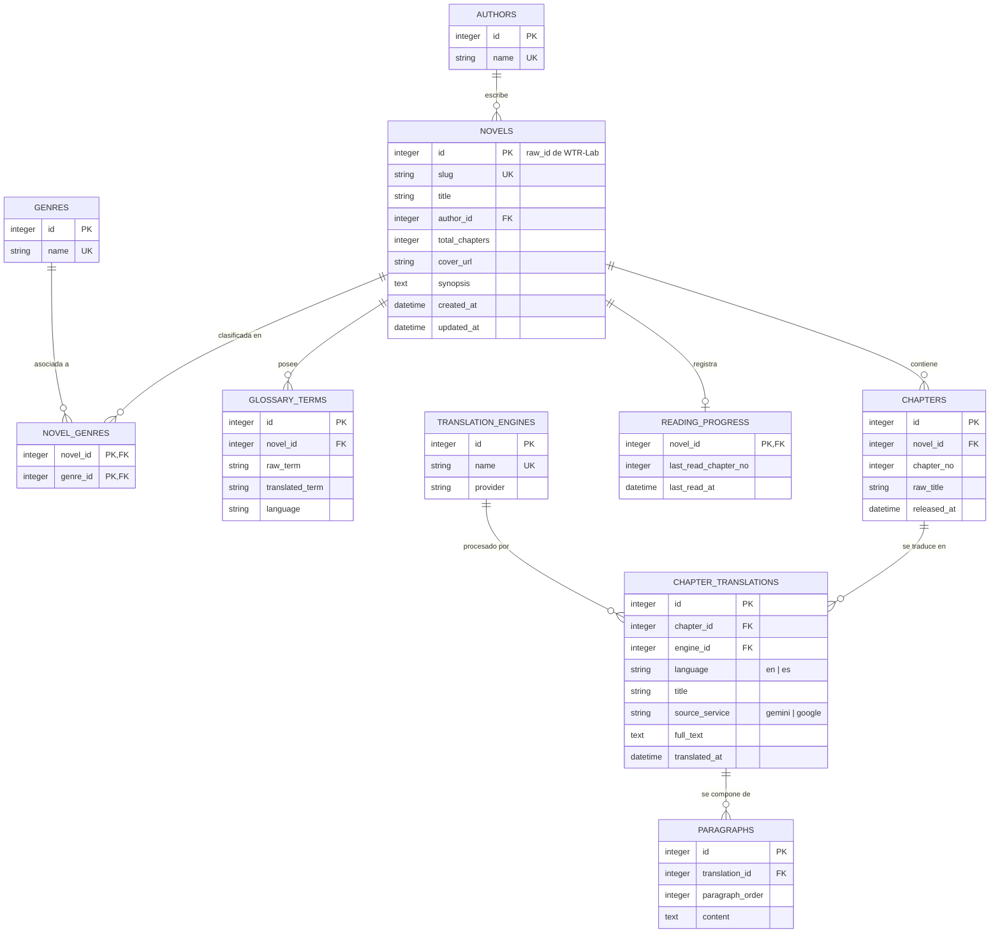

# Base de Datos SQLite (Normalizada en 3NF) 💾

Este documento describe el diseño, relaciones y estructura de la base de datos local SQLite implementada en el proyecto con el módulo nativo `node:sqlite`.

---

## 1. Ubicación y Archivo de Base de Datos

- **Ruta por defecto**: `data/novels.db`
- **Motor**: SQLite 3 nativo vía `node:sqlite` (Node.js v26+).
- **Modo WAL**: Write-Ahead Logging habilitado para permitir lecturas y escrituras simultáneas ultra-rápidas.
- **Integridad Referencial**: `PRAGMA foreign_keys = ON;` activo para garantizar consistencia.

---

## 2. Diagrama Entidad-Relación (ERD)



---

## 3. Diccionario de Datos

### `novels`
Contiene la información de cabecera de cada novela.
- `id` (INTEGER, PK): ID canónico (`raw_id`) de WTR-Lab.
- `slug` (TEXT, UNIQUE): Identificador legible para URLs y carpetas.
- `title` (TEXT): Título en inglés o internacional.
- `author_id` (INTEGER, FK): Referencia a la tabla `authors`.
- `total_chapters` (INTEGER): Cantidad total de capítulos existentes en origen.

### `chapters`
Entidad canónica de capítulo independiente del idioma de traducción.
- `id` (INTEGER, PK): Autoincremental interno.
- `novel_id` (INTEGER, FK): Referencia a `novels.id`.
- `chapter_no` (INTEGER): Número/orden del capítulo (1, 2, 3...).
- `raw_title` (TEXT): Título original en chino (ej: `第1章 异宝残根`).
- Restricción: `UNIQUE(novel_id, chapter_no)`.

### `chapter_translations`
Almacena las distintas versiones traducidas de un capítulo.
- `id` (INTEGER, PK): Autoincremental interno.
- `chapter_id` (INTEGER, FK): Referencia a `chapters.id`.
- `engine_id` (INTEGER, FK): Referencia a `translation_engines.id`.
- `language` (TEXT): Código ISO del idioma (`en`, `es`).
- `title` (TEXT): Título traducido en ese idioma.
- `source_service` (TEXT): Motor de origen (`gemini`, `google`).
- `full_text` (TEXT): Texto completo renderizado para exportación rápida.
- Restricción: `UNIQUE(chapter_id, language, engine_id)`.

### `paragraphs`
Párrafos atómicos en Primera Forma Normal (1NF).
- `id` (INTEGER, PK): Autoincremental interno.
- `translation_id` (INTEGER, FK): Referencia a `chapter_translations.id`.
- `paragraph_order` (INTEGER): Posición secuencial del párrafo (1, 2, 3...).
- `content` (TEXT): Contenido textual del párrafo.
- Restricción: `UNIQUE(translation_id, paragraph_order)`.

### `glossary_terms`
Diccionario oficial de la novela extraído del backend de WTR-Lab.
- `novel_id` (INTEGER, FK): Referencia a `novels.id`.
- `raw_term` (TEXT): Término en chino (ej: `筑基`).
- `translated_term` (TEXT): Traducción oficial (ej: `Foundation Establishment`).
- `language` (TEXT): Idioma del término (`en`, `es`).

---

## 4. Gestión y Respaldos de la Base de Datos

### Copia de Respaldo:
Como SQLite es un archivo único en disco, puedes realizar un backup en caliente simplemente copiando el archivo:
```bash
cp data/novels.db data/novels_backup.db
```

### Inspección con herramientas gráficas:
Puedes abrir `data/novels.db` directamente con:
- **DB Browser for SQLite** (Windows / Linux / macOS)
- **DBeaver**
- Extensión **SQLite Viewer** en VS Code o Cursor
